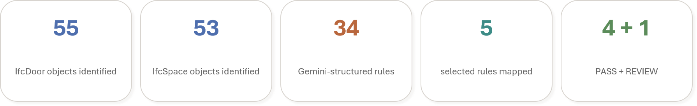
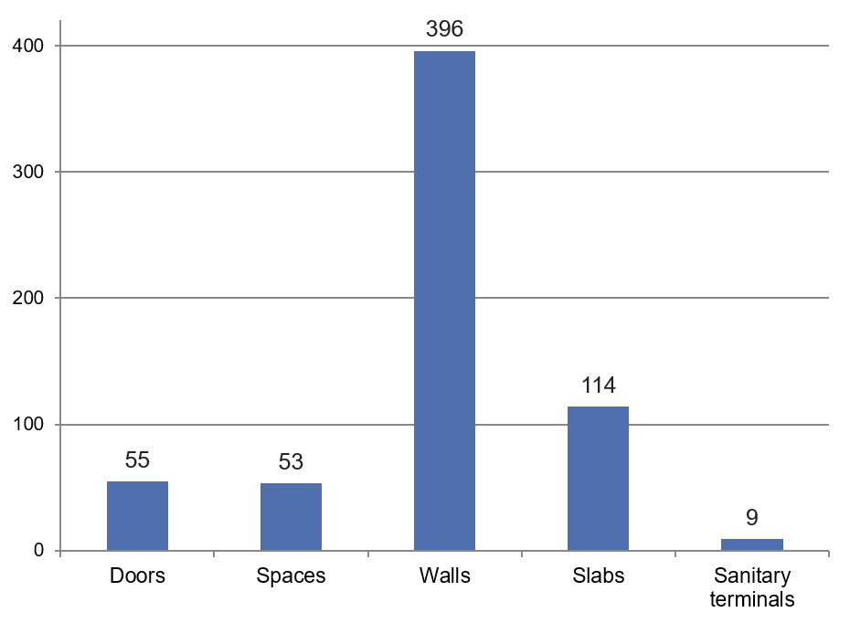
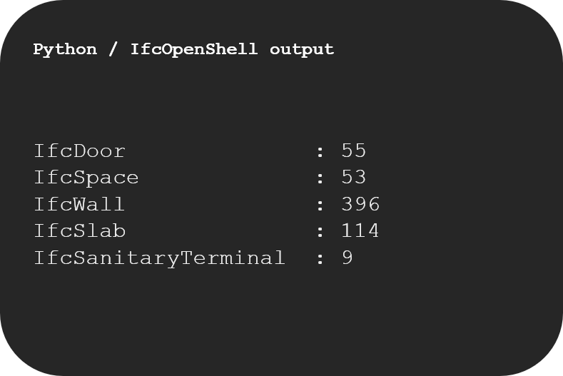
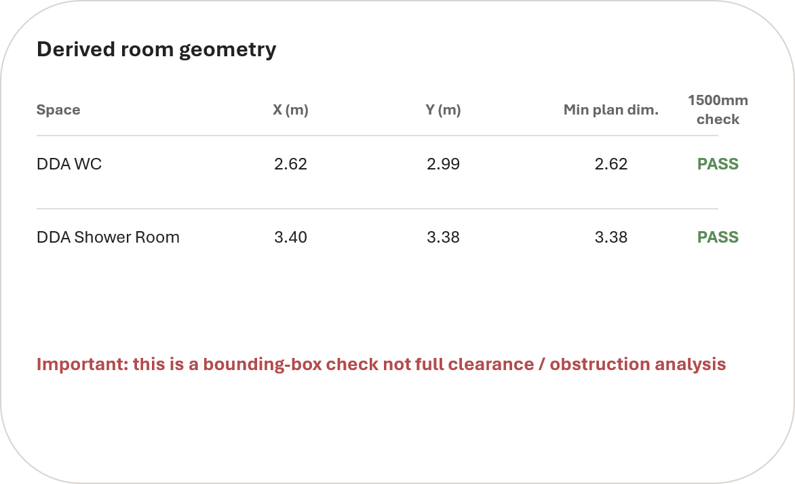
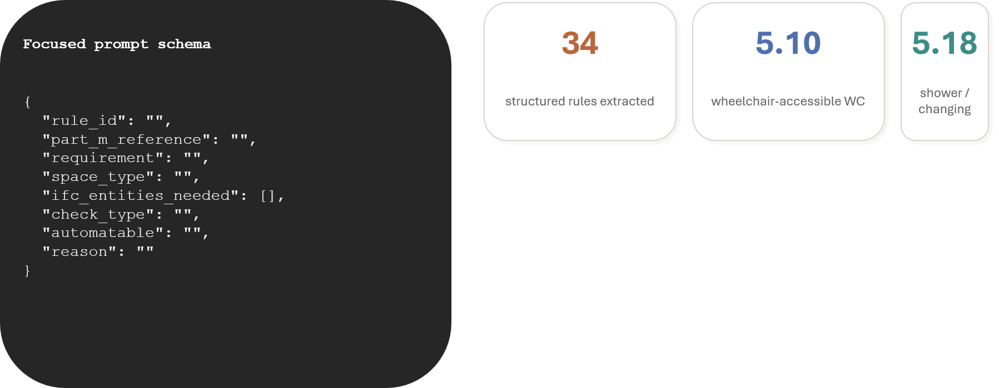
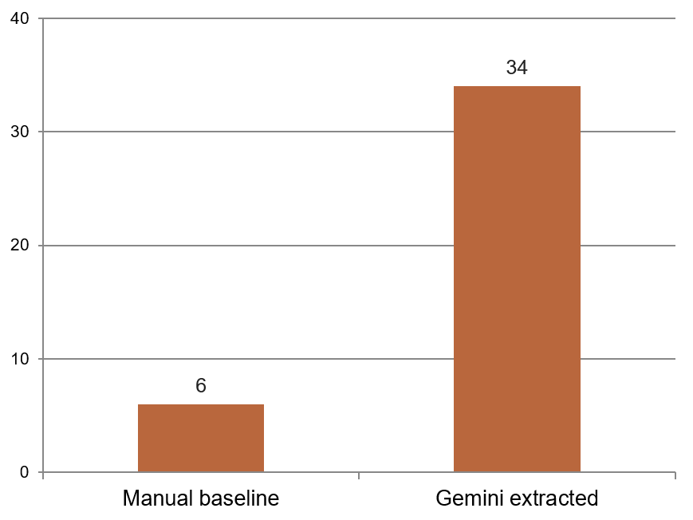
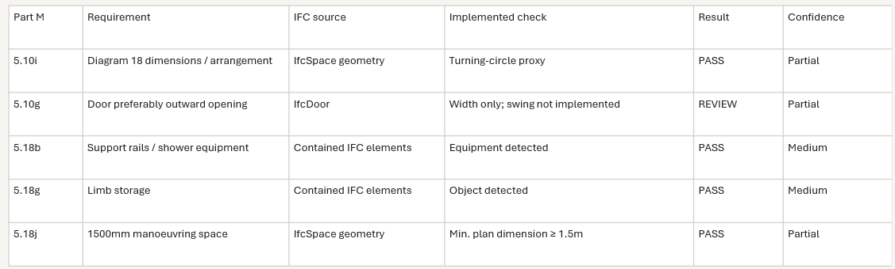

# AI-Assisted Automated Compliance Checker

### Bridging the Gap Between Manual and AI-Assisted BIM Compliance Checking

**Python | IfcOpenShell | BIM | Google Gemini | UK Approved Document M**

A research prototype exploring how Building Information Modelling (BIM), Industry Foundation Classes (IFC) and Large Language Models (LLMs) can support preliminary building regulation compliance checking within architectural practice.

Developed during an MSc Artificial Intelligence for Engineering and Design placement project, this study combines IFC data extraction, Python-based geometric and attribute checks, and Gemini-assisted regulatory rule extraction.

> **Research prototype:** This project provides preliminary decision support. It does not establish full building regulation compliance or replace professional architectural judgement.

---

## 1. Project Overview

Building regulation compliance checking remains largely manual despite the increasing availability of structured building information through BIM.

Architects must interpret regulatory documents, examine drawings and model information, and determine whether designs satisfy relevant requirements.

This project investigates how selected stages of this process could be supported through automation, focusing on **Approved Document M, Volume 2, Section 5: Sanitary Accommodation**.

The project explores four connected activities:

1. Extracting building element information from IFC models.
2. Implementing preliminary Python-based compliance checks.
3. Using Google Gemini to convert regulatory text into structured rules.
4. Mapping AI-extracted rules to IFC-based checks and identifying where professional review remains necessary.

## 2. Research Results

The prototype demonstrated a working process for extracting BIM data, structuring regulatory requirements and connecting selected rules to preliminary checks.



| Research component | Prototype result |
|---|---|
| IFC doors identified | 55 |
| IFC spaces identified | 53 |
| Structured Part M rules extracted using Gemini | 34 |
| Rules selected for BIM mapping | 5 |
| Prototype mapping outcomes | 4 PASS, 1 REVIEW |

**Important:** PASS refers to the outcome of the implemented prototype check, not confirmation of statutory compliance. Some checks used simplified geometric proxies or object-presence detection.

## 3. Technologies Used

| Technology | Application |
|---|---|
| Python | Data processing and preliminary compliance checks |
| IfcOpenShell | IFC object, attribute and geometry extraction |
| Autodesk Revit | Source BIM authoring environment and IFC export |
| pandas and NumPy | Data analysis and processing |
| pypdf | Regulatory PDF text extraction |
| Google Gemini 2.5 Flash | LLM-assisted rule extraction |
| JSON | Structured rule representation |
| openpyxl | Excel output support |
| Jupyter Notebook | Experimental implementation |
| Matplotlib | Results visualisation |

## 4. Methodology

### Stage 1: IFC Model Exploration

The workflow begins with an IFC export from a BIM authoring environment.

Python and IfcOpenShell are used to access IFC entities, element properties, spatial information and available geometric representations.

The experimental model contained the following elements:



The extracted IFC entity counts were:

| IFC entity | Count |
|---|---:|
| IfcDoor | 55 |
| IfcSpace | 53 |
| IfcWall | 396 |
| IfcSlab | 114 |
| IfcSanitaryTerminal | 9 |

The IFC data could be accessed and inspected computationally without relying directly on Revit for the checking process.



**Key observation:** IFC elements were not always classified consistently. Some sanitary-related fixtures appeared under alternative IFC entity types, demonstrating the importance of model information quality and appropriate object classification.

### Stage 2: Preliminary Geometric and Attribute-Based Checks

The next stage investigated whether extracted IFC information could support simple regulatory checks.

The prototype explored:

- Door width extraction and preliminary threshold checking.
- Identification of accessibility-related spaces.
- Space dimension estimation through IFC geometry.
- Simplified minimum-plan-dimension checking.
- Detection of sanitary fittings and accessibility equipment.

#### IFC space geometry

When room dimensions were not available as exported quantities, IfcOpenShell geometry tools were used to calculate approximate bounding-box dimensions from geometric coordinates.

*The following model-derived figure should only be published after confidentiality clearance or replacement with synthetic data.*



These checks considered the minimum bounding-box plan dimension against a simplified 1.5 m threshold.

**Geometric limitation:** A bounding box only describes the approximate overall geometric extents. It does not determine whether a clear 1500 mm turning circle fits within the usable space or whether sanitary fittings, obstructions and door swings satisfy the relevant regulatory diagrams.

Accordingly, these results should be interpreted as preliminary geometric indicators rather than verified accessibility compliance.

### Stage 3: LLM-Assisted Regulatory Rule Extraction

Approved Document M, Volume 2, Section 5 was selected to investigate sanitary accommodation requirements, particularly wheelchair-accessible toilets, showers and changing facilities.

The relevant regulatory text was extracted from the official PDF using Python and `pypdf`.

Google Gemini 2.5 Flash was then prompted to transform the extracted text into a structured JSON format.



The JSON schema included the following fields:

```json
{
  "rule_id": "",
  "part_m_reference": "",
  "requirement": "",
  "space_type": "",
  "ifc_entities_needed": [],
  "check_type": "",
  "automatable": "",
  "reason": ""
}
```

The extracted rules covered requirements related to wheelchair-accessible WC facilities, showers, changing facilities, support rails, emergency assistance arrangements and manoeuvring provisions.

**Result:** Gemini generated 34 structured requirements from the focused regulatory text.

The LLM output was treated as a draft rule dataset requiring review rather than automatically validated building regulations.

### Stage 4: Manual and AI-Assisted Rule Extraction Comparison

An initial manual rule table was developed before the LLM extraction stage.

The Gemini-generated rules were then compared with this manual baseline to examine whether an LLM could support the identification and organisation of regulatory requirements.



The focused evaluation identified six requirements that were not included in the initial manual extraction, demonstrating the potential usefulness of LLMs for supplementary rule discovery.

However, identifying additional requirements does not necessarily establish their correctness, relevance or feasibility for automated BIM checking.

### Stage 5: Mapping Regulatory Rules to IFC Checks

Five selected Part M requirements were mapped to available IFC information and implemented prototype checks.

The mapping considered:

- Regulatory requirement and clause reference.
- IFC element or geometry source.
- Implemented checking method.
- Preliminary outcome.
- Confidence and implementation limitations.

*The following mapping image uses project-derived prototype outcomes and should undergo confidentiality review before public release.*



The five selected mappings produced four preliminary PASS outcomes and one REVIEW outcome.

These outcomes were not equally reliable. Object-detection checks provided evidence that relevant fittings were present, but did not establish their full regulatory arrangement or installation suitability.

Similarly, dimension-based checks used simplified geometry and did not validate detailed clearances or circulation.

## 5. Key Findings

**IFC can support preliminary automated checking.** The prototype successfully accessed structured building elements, properties and geometric representations through IfcOpenShell.

**Simple measurable checks are more suitable for automation.** Door dimensions, object presence and selected spatial measurements could be processed computationally.

**LLMs can support regulatory rule structuring.** Gemini converted focused Part M text into 34 structured requirements, supporting regulatory organisation and rule discovery.

**BIM data quality directly affects reliability.** Inconsistent object classifications, naming conventions and missing quantities limited the range of checks that could be implemented.

**Rule extraction and compliance verification are different activities.** An LLM may identify a relevant requirement without the IFC model containing enough evidence to verify it.

**Professional judgement remains essential.** Complex spatial relationships, regulatory exceptions and diagram-based requirements could not be fully assessed using the prototype.

## 6. Repository Structure

```text
automated-compliance-checker/
├── Visuals/
│   ├── results_summary.png
│   ├── ifc_element_counts.png
│   ├── ifc_extraction.png
│   ├── room_geometry.png
│   ├── llm_rule_extraction.png
│   ├── rule_comparison.png
│   └── rule_mapping.png
├── docs/
│   └── rule_extraction_prompt.txt
├── notebooks/
│   ├── 01_IFC_Exploration.ipynb
│   └── 02_PartM_Rule_Extraction.ipynb
├── src/
│   ├── read_ifc.py
│   └── test_setup.py
├── tools/
│   └── create_partm_visuals.py
├── .gitignore
├── README.md
└── requirements.txt
```

Confidential BIM models, original project data, locally generated output datasets and API credentials are excluded from the repository.

## 7. Installation and Setup

### Clone the repository

```bash
git clone https://github.com/riyar275/automated-compliance-checker.git
cd automated-compliance-checker
```

### Create a Python virtual environment

```bash
python -m venv .venv
```

Activate the environment on Windows PowerShell:

```powershell
.\.venv\Scripts\Activate.ps1
```

### Install dependencies

```bash
python -m pip install -r requirements.txt
```

### Provide an IFC model

Create a local directory:

```text
data/ifc/
```

Place an IFC model named `sample_model.ifc` inside this folder.

The original case-study IFC model is not provided. Users must supply a suitable model for testing.

### Download Approved Document M

The regulatory text is obtained from:

[UK Government: Approved Document M](https://www.gov.uk/government/publications/access-to-and-use-of-buildings-approved-document-m)

This study used Volume 2, Buildings other than dwellings, with reference to the 2015 edition incorporating the 2020 and 2024 amendments.

Save the required PDF locally as:

```text
docs/Approved_Document_M_Volume_2.pdf
```

The PDF is not included in this repository.

### Configure Gemini

Create a Gemini API key using [Google AI Studio](https://aistudio.google.com/apikey).

Set the `GEMINI_API_KEY` environment variable securely in your local environment.

Do not place credentials directly inside notebooks or commit them to Git.

### Run the notebooks

Open the following notebooks in Jupyter or VS Code:

- `01_IFC_Exploration.ipynb`: IFC data inspection and prototype checks.
- `02_PartM_Rule_Extraction.ipynb`: Regulatory text processing, Gemini rule extraction and mapping.

The notebooks should be run from the `notebooks/` working directory to preserve their relative file paths.

The scripts are research prototypes and may require adaptations for different IFC models, classifications and file structures.

## 8. Limitations

The prototype has several limitations:

1. **IFC information completeness:** The required geometry, object properties and spatial relationships may not be consistently available.
2. **Element classification:** Sanitary equipment may appear under different IFC entity types.
3. **Bounding-box approximation:** Derived dimensions do not establish usable wheelchair manoeuvring clearance.
4. **Diagram interpretation:** Regulatory diagrams were not automatically converted into checkable spatial rules.
5. **LLM reliability:** Extracted rules require human verification against the authoritative regulatory source.
6. **Generalisability:** The workflow was explored as a limited research prototype and has not been validated across a representative range of building models.

The system should therefore be considered a preliminary design-review aid, not a complete automated regulation approval tool.

## 9. Future Development

Future improvements could include better BIM naming and classification standards, accurate fixture and clearance geometry analysis, diagram-based rule interpretation, structured validation of LLM outputs, and comparison of IFC-based checking against direct Revit API data extraction.

Further testing on appropriately authorised datasets and different building types would be required to evaluate wider applicability.

## 10. Confidentiality and Research Context

This project was developed through an MSc Artificial Intelligence for Engineering and Design placement investigation within an architectural practice.

The research implementation has been separated from the original case-study BIM model and confidential project datasets.

The repository is intended to document the computational methodology and experimental workflow. It does not distribute the underlying architectural project or provide approval to reuse any third-party intellectual property.

## Copyright and License

Copyright © 2026 Riya Ramesh.

This project is licensed under the MIT License. See the LICENSE file for the full license terms.

The copyright and license apply only to the original code, documentation and research materials that the author is authorised to distribute. Third-party materials and intellectual property remain subject to their respective owners' rights.

## Disclaimer

This repository is provided for academic research, technical exploration and educational purposes.

Results are preliminary and must not be interpreted as evidence of statutory compliance with UK Building Regulations. Regulatory decisions require appropriate professional assessment and reference to the applicable official documents.


## Citation

If you use this repository, its code or methodology in academic research, please cite:

Ramesh, R. (2026) AI-Assisted Automated Compliance Checker: Bridging the Gap Between Manual and AI-Assisted BIM Compliance Checking. GitHub repository. Available at: https://github.com/riyar275/automated-compliance-checker